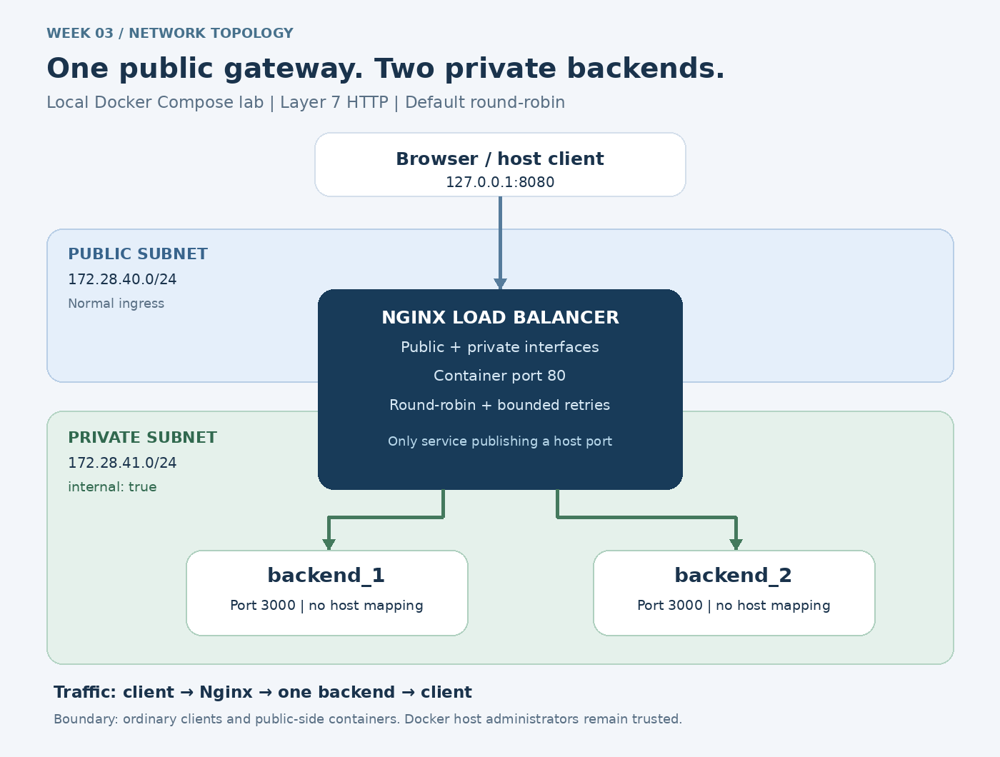

# Week 03 — Network Segmentation and Load Balancing

A local Docker lab with Nginx and two Python backends. No API keys, paid cloud account, database, or Python packages are needed.

## Start here (Windows)

1. Install **Docker Desktop** with its WSL 2 / Linux containers backend, then open Docker Desktop and wait until the engine is running. If prompted to install WSL, follow Docker's setup instructions and restart Windows. This lab requires Docker; Streamlit Cloud and GitHub Pages cannot run its private container networks.
2. Install Python 3.11 or later if it is not already installed. You can use PowerShell, Git Bash, or a VS Code terminal. VS Code itself is optional.
3. Extract this folder somewhere simple, such as `C:\Users\eleni\Projects\week03-network-loadbalancer`. Open PowerShell **inside the folder containing `compose.yaml`**.
4. Verify the prerequisites:

```powershell
docker version
docker compose version
python --version
```

If `python` is not recognized but `py` works, replace `python` with `py` below.

5. Build and start:

```powershell
docker compose up -d --build --wait --wait-timeout 120
docker compose ps
docker compose exec loadbalancer nginx -t
```

Open **http://127.0.0.1:8080**. The page shows the backend ID. Images are downloaded the first time; allow a few minutes on a slow connection.

6. Run the actual QA checks:

```powershell
python scripts/qa.py all
```

Keep other browser traffic to this lab idle during the distribution check. The script expects exactly 10 uninterrupted API requests, alternating 5/5. Backend container health checks do not pass through the balancer and therefore do not affect that count.

The suite audits the running configuration, checks health, tests distribution, stops a backend, verifies failover, restarts it, verifies recovery, checks for host port leaks, and starts a temporary public-side network probe. JSON evidence is written into `artifacts/`. The failover test restores backend_1 in a `finally` block.

On macOS/Linux, use the same Docker commands and `python3 scripts/qa.py all`.

## Architecture



| Service | Networks | Host port | Role |
| --- | --- | --- | --- |
| loadbalancer | public_subnet + private_subnet | 127.0.0.1:8080 → container 80 | Nginx L7 HTTP gateway, default round-robin |
| backend_1 | private_subnet only | None | Stateless Python HTTP app, container port 3000 |
| backend_2 | private_subnet only | None | Same app, different SERVER_ID |
| probe (test only) | public_subnet only | None | Checks the gateway is reachable and private backends are blocked |

The public bridge uses `172.28.40.0/24`. The private bridge uses `172.28.41.0/24` and `internal: true`. Only Nginx is dual-homed. Backends use service names in the upstream pool; Docker assigns their IPs. The Nginx image supports dynamic upstream DNS resolution so replacing a backend container does not require hardcoding its new address.

## What the endpoints mean

| Endpoint | Meaning |
| --- | --- |
| `/` | Browser demonstration with the responding backend ID |
| `/api/whoami` | Small JSON response used for exact request counting |
| `/healthz` | Nginx gateway liveness (200 does not prove backend availability) |
| `/readyz` | Request proxied to a backend health endpoint |

Docker health checks indicate container health. Nginx Open Source here uses **passive upstream failure detection**, not an active health-check scheduler. A failed upstream connection can be retried against the other backend; the failed node is temporarily avoided and later tried again.

## Live demonstration commands

See [the simple speaker notes](docs/video-walkthrough.md) for the full 6-minute sequence.

```powershell
python scripts/qa.py distribution
python scripts/qa.py failover
python scripts/qa.py isolation
python scripts/qa.py health
docker compose logs --tail 30 loadbalancer
```

For a manual failover demonstration:

```powershell
docker compose stop --timeout 0 backend_1
1..10 | ForEach-Object { (Invoke-RestMethod http://127.0.0.1:8080/api/whoami).server_id }
docker compose start backend_1
```

Allow a few seconds after restart for passive failure suppression to expire. Then rerun the distribution check. If you close the terminal during a test, restore with `docker compose start backend_1`.

For the required host-port negative check:

```powershell
curl.exe --max-time 2 http://127.0.0.1:3001
```

Connection failure is the expected result. The automated test also checks ports 3000/3002 and the actual container port bindings, then attempts private IP access from the public-side probe. An unrelated local service on these ports makes the test fail; stop that service and rerun.

## Important limits of this demonstration

- **No host port publication is not complete host isolation.** A native Linux Docker host may reach bridge container IPs directly, and an administrator can use `docker exec` or attach a container to a network. The tested boundary is an ordinary client or public-side container, not a malicious host administrator. `expose` documents a container port; it is not a firewall rule.
- Backend peers share the private bridge and can reach each other. This is tier segmentation, not per-service zero trust. The dual-homed proxy also remains a trusted component.
- The demo is HTTP on loopback for local recording. It does not implement TLS, WAF rules, authentication, or DDoS protection. Do not describe these as deployed features.
- “Zero dropped requests” is a measured goal for this lab's small stateless GET requests with one backend alive. Nginx cannot promise lossless failover after response bytes reach a client, for every POST, or when both nodes fail. Retrying writes safely requires application-level duplicate protection.
- There is one gateway and one Docker host, so both remain single points of failure. Backend failover is not multi-host high availability.
- Docker image tags are version-scoped but not digest-pinned. For production, pin audited digests and maintain an update process. The Python standard-library server is for this classroom demonstration.

## AI audit and evidence

- [AI assistance and prompt log](docs/ai-prompts.md)
- [Draft review and corrections](docs/network-audit.md)
- [QA checklist and evidence fields](docs/qa-checklist.md)
- [Verification completed while preparing the project](docs/verification.md)
- [Video walkthrough](docs/video-walkthrough.md)
- [Submission text](docs/submission.md)

The files in `docs/review-draft-*.txt` are intentionally flawed **review examples** prepared for the audit exercise. They are not active Compose or Nginx configuration. The corrected runtime files are `compose.yaml` and `nginx/nginx.conf`.

## GitHub submission

Create an **empty** repository named `week03-network-loadbalancer` in your GitHub account. Do not initialize it with a README, license, or .gitignore, since this folder already has project files. Then run these commands from this folder:

```powershell
git init
git add .
git commit -m "Add segmented Docker topology and load-balancer QA"
git branch -M main
git remote add origin https://github.com/Elenimulu789/week03-network-loadbalancer.git
git push -u origin main
```

Authenticate through Git Credential Manager if prompted. No credentials belong in project files. The included GitHub Actions workflow runs Docker QA on pushes and pull requests and uploads its logs under **Actions → Network QA → network-qa-evidence**. A green workflow result is evidence only after it actually runs.

## Stop and troubleshooting

```powershell
docker compose down
```

Do not use `down -v`; this lab has no persistent volumes to remove.

- **Cannot connect to Docker daemon:** open Docker Desktop and wait for it to start. Use Linux containers.
- **Port 8080 already allocated:** stop the application occupying it. This suite intentionally uses a fixed local URL.
- **Overlapping subnet:** use `docker network ls` / `docker network inspect` to identify the conflict, then choose two unused private /24 ranges in `compose.yaml`. The code does not depend on the particular ranges.
- **Nginx unhealthy:** inspect `docker compose logs loadbalancer` and `docker compose exec loadbalancer nginx -t`.
- **Image pull timeout:** check internet connectivity and retry the start command.
- **Uneven distribution:** close other lab tabs or terminal request loops, restore both backends, wait a few seconds, and rerun.
- **Both backends stopped:** requests can return 502; start at least one backend. `/healthz` intentionally still reports gateway liveness.

## References

- [Docker Compose networking](https://docs.docker.com/compose/how-tos/networking/)
- [Docker bridge networks and host access](https://docs.docker.com/engine/network/)
- [Docker port publishing](https://docs.docker.com/engine/network/port-publishing/)
- [Nginx upstream groups, resolve, failure handling](https://nginx.org/en/docs/http/ngx_http_upstream_module.html)
- [Nginx proxy retry directives](https://nginx.org/en/docs/http/ngx_http_proxy_module.html#proxy_next_upstream)
